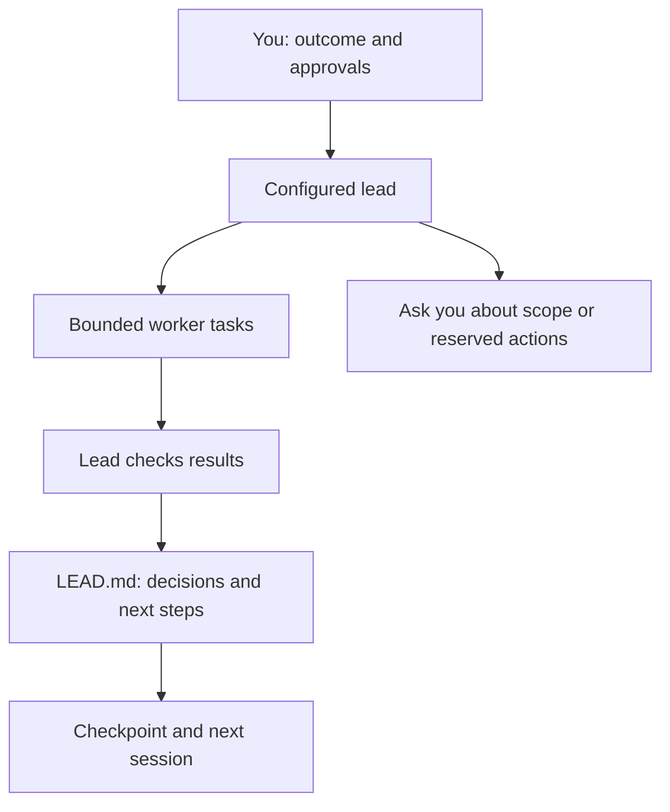

# Lead kit

<p><a href="assets/workstack-mark-full.png"></a></p>

**Give one AI lead responsibility for an outcome, not just the next prompt.**
Lead kit supplies reusable instructions for planning, bounded workers, decisions,
verification and handovers, plus a small installer for your agent harness.

## Why use it?

A longer project needs more than a chat transcript. Someone has to keep the goal
intact, divide up work, check results and remember why decisions were made.
This kit gives that role a repeatable starting point:

- **Engineering:** coordinate implementation and review while keeping decisions
  and failed approaches in one project log.
- **Research:** split a question into bounded investigations, check the results
  and carry unresolved questions into the next session.
- **Life admin:** keep a multi-step outcome, approvals and follow-ups together
  without treating a reminder as permission to act.

The lead maintains `LEAD.md` and longer notes in `lead/`. Its named checkpoint
instructions help the next session resume without relying on chat history.
You can combine the three practice packs.

## What it is—and isn't

This is an **instruction kit and installer**, not an agent runtime, daemon,
scheduler or security sandbox. You supply the host, models, tools and permissions.
No Chief installation, private memory, routing service or paid subscription is
bundled or required by the kit itself.

This repository ships the standalone bundle included here. It is not
automatically synchronized with the current Chief kit or with agents you have
already installed. Review this bundle's behavior on its own; installing it does
not update Chief or adopt changes from another project.



This describes the intended working pattern, not an automatically enforced engine.
The lead's editing role is deliberately narrow: keep the log and delegate work
when the host provides suitable worker tools.

## Requirements and host fit

- A POSIX environment with **Bash and Python 3.9+**; Python standard library only.
- An installed, configured host with model access and permission to use the tools
  your project needs. Review the rendered instructions before installing them.
- For the full worker/reporting workflow, compatible session tools. The shared
  instructions name `a2a_create` and OpenChamber `session.send`; a plain chat
  harness does not acquire those capabilities by installing this kit.

| Host target | What the installer writes | What you must check |
|---|---|---|
| OpenCode / OpenChamber | Primary agent Markdown and checkpoint command | Agent discovery, permission rules and available session tools |
| Claude Code | Agent Markdown and checkpoint skill | Agent discovery and available Agent tools; shared OpenChamber calls are not native Claude tools |
| Codex | TOML instruction fragment and checkpoint skill | Load the fragment through your host's supported configuration; copying it alone does not activate an agent |

The adapters render files for all three targets; that is **not live compatibility
certification for every host version**. Only OpenCode/OpenChamber integrations
can provide the named session workflow directly. Claude Code and Codex adapters
tell the lead to use available local worker tools and report blocked delivery.
The common body still contains OpenChamber-specific instructions: review their
fit rather than treating the adapters as interchangeable.

No native goal engine is installed. Any supported OpenCode goal mode needs
explicit operator binding; the Claude Code and Codex adapters provide no goal
mode. Tool policies and prompt instructions are not isolation boundaries.

## Get started

Clone the repository, then start with the direct-to-you example:

```sh
git clone https://github.com/batteryshark/lead-kit.git
cd lead-kit
cp examples/principal.json my-lead.json
```

Edit `my-lead.json` to choose your agent name, practice packs and reporting style.
The JSON field `owner.mode: "principal"` means “report to me in this conversation.”
For example:

```json
{
  "version": 1,
  "agent": "study-lead",
  "packs": ["research"],
  "owner": {
    "mode": "principal",
    "style": "Short outcomes with evidence on request."
  }
}
```

Choose a lowercase name beginning with a letter (letters, digits and hyphens,
up to 48 characters). `lead`, `chief-of-staff`, `shape` and `checkpoint` are
reserved. Packs are `engineering`, `research` and `life-admin`, without duplicates.

Preview one target without writing its configuration, then install that target:

```sh
bash install.sh --lead-config my-lead.json --print opencode
bash install.sh --lead-config my-lead.json opencode
```

Use `claude` or `codex` instead of `opencode` for another target. **Omitting the
target selects all three.** `--dry-run` lists destinations without writing them.
Both preview modes validate ownership and paths, so an existing unowned file can
block even a preview.

In a project folder, write down the agreed outcome and constraints in
`PROJECT.md`. Select the installed `study-lead` agent in a compatible host (or
explicitly load the Codex fragment), then give it the outcome and ask it to
maintain `LEAD.md`. For example:

> Compare three backup approaches for this project. Do not buy anything or
> contact anyone. Record the options, recommendation and open decisions in
> LEAD.md; ask me before changing scope.

The example installs the checkpoint resource `study-lead-checkpoint`: an
OpenCode command or a Claude/Codex skill. Invoke it before handing over or
starting a fresh session. The engineering pack keeps sessions in the project
folder unless you explicitly request a move to a worktree.

### Where files go and how to undo it

The installer writes beneath the selected `HOME` (it does not use
`XDG_CONFIG_HOME` to choose installation paths):

- OpenCode: `.config/opencode/agents/<agent>.md` and
  `.config/opencode/commands/<agent>-checkpoint.md`.
- Claude Code: `.claude/agents/<agent>.md` and
  `.claude/skills/<agent>-checkpoint/SKILL.md`.
- Codex: `.codex/<agent>.config.toml` and
  `.codex/skills/<agent>-checkpoint/SKILL.md`.

Change the config or source and reinstall rather than editing managed output.
To remove only this lead's managed files for the selected host:

```sh
bash install.sh --lead-config my-lead.json --uninstall opencode
```

Keep the same agent name and select every host you installed. The installer
refuses unowned target files and symlinked descendants, and preflights all targets
before writing. It intentionally retains the `chief-of-staff/install.sh` marker
for compatibility. Empty directories may remain. Files are replaced individually,
not as one transaction; path races and partial I/O failures are not ruled out.

### Optional reporting and services

For reporting to another agent, adapt [examples/agent.json](examples/agent.json)
to an absolute, operator-controlled pointer file. Its live `session` and absolute
`directory` identify the destination; re-read them before every send.
[examples/owner.json](examples/owner.json) is a blank template, **not a working
destination**. Never deliver to its example paths or guess a session. If delivery
tools or a valid destination are missing, log the blockage and ask you directly;
uncertain delivery is not permission to retry blindly.

[Docket guidance](kits/shared/docket.md) and [Fleet guidance](kits/shared/fleet.md)
are optional instructions, not service installations. Use only services and
guides you explicitly configure. No implicit service startup or external contact
is authorized.

## Checks and limits

Run the offline fixtures with:

```sh
python3 -B -m unittest discover -s tests -v
```

They render, install, reinstall and uninstall inside temporary homes, and check
config rejection, ownership and path guards. They do not start host servers or
prove live agent activation, delivery, goal execution or sandboxing. Host
integration should be checked on an isolated configuration before real work.

## License and artwork

Source and documentation: [MIT](LICENSE). The existing comic marks are
**AI-generated artwork**, offered on MIT terms to the extent applicable, with
no exclusive copyright claim in AI-generated elements. See [RIGHTS.md](RIGHTS.md)
and [ATTRIBUTION.md](ATTRIBUTION.md).
