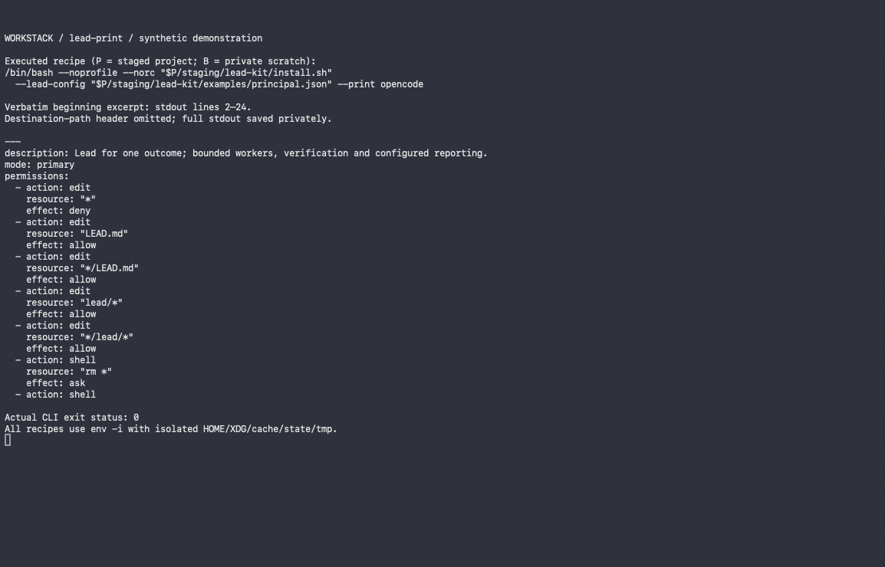

# Lead kit

<p><a href="assets/workstack-mark-full.png"></a></p>

Reviewed comic mark, locally wired only; not a product capture, native acceptance or release clearance.
[Small-use Tiny32](assets/workstack-mark-32.png) is a separately designed composition, not a shrunk badge.

One outcome, one accountable lead: planning, bounded workers, decisions,
verification, a durable `LEAD.md` and checkpoint/handover instructions. This is
an instruction kit and installer, not a daemon or autonomous execution engine.
No Chief installation is required.

## Requirements and installation

Use a POSIX system with Bash and Python 3.9+ (stdlib only). Host applications and
their permissions/tools are supplied separately. From this repository:

```sh
./install.sh --lead-config examples/principal.json --print
./install.sh --lead-config examples/principal.json opencode claude codex
./install.sh --lead-config examples/principal.json --uninstall
```

Install writes only the selected host's agent/checkpoint surfaces under `HOME`:
OpenCode `.config/opencode/{agents,commands}`, Claude `.claude/{agents,skills}`,
Codex `.codex/*.config.toml` and `.codex/skills`. Load the Codex instruction
fragment through your host's supported configuration mechanism; copying it is
not proof that a particular Codex release activated it. Uninstall removes only
files bearing this lead's exact managed marker; it preserves unowned files and
refuses symlinked descendants. Empty parent directories can remain. Do not edit
managed output: change config/source and reinstall. The compatibility marker
still names `chief-of-staff/install.sh` intentionally.

Choose an available nonreserved `agent` name and practice packs (`engineering`,
`research`, `life-admin`, combinable). Names `lead`, `chief-of-staff`, `shape` and
`checkpoint` are reserved. Checkpoints are `<agent>-checkpoint`. Invoke the
installed host agent for a shaped outcome; require it to maintain `LEAD.md`.
The engineering pack preserves the rule to keep sessions in the project folder
unless explicitly asked to move to a worktree.

## Reporting, optional integrations and stack fit

`examples/principal.json` reports directly in the conversation. For agent
reporting, adapt `examples/agent.json` to an absolute operator-owned pointer.
`examples/owner.json` is deliberately blank and invalid for delivery until the
operator supplies a real session, directory and update time. Never use its
synthetic `/example` paths as authority. Re-read the live pointer before every
send; blocked/uncertain delivery is logged, not guessed or blindly retried.

Docket and Fleet are external and optional. `kits/shared` contains conditional
guidance, not service provisioning or local topology. Operators supply approved
installation/CLI guides and permissions in their project instructions. No model
policy, paid budget, private memory, credential or reach-out service is bundled.
Chief composes this exact version as a pinned vendored module; this repository
is the only maintained Lead core. Do not patch its copy inside Chief.

## Support matrix and limits

| Capability | OpenCode/OpenChamber | Claude Code | Codex |
|---|---|---|---|
| Independent install/render/uninstall fixtures | Yes | Yes | Yes |
| Agent and namespaced checkpoint instructions | Yes | Yes | Yes |
| Native goal/runtime binding | Local host/operator integration only | Not provided | Not provided |
| Security sandbox | No | No | No |

Tool availability and host activation must be checked by the operator. Three-host
rendering is not three-host goal-engine or sandbox parity. a2a has no goal flag.
Permission policies and destination preflight are not security isolation; path
races and partial per-file I/O failures remain outside the guard's guarantee.

## Validation and release status

Run `python3 -B -m unittest discover -s tests -v` with temporary HOME/XDG/TMPDIR.
Fixtures install only into their own temporary homes; no host server is started.
Version `0.1.0-staging.1` is a local source snapshot, not a published release or
full live-host acceptance. `PROVENANCE.json` records pin, edits and content hashes.
Licensing/redistribution, scanner review and assets remain gated; see
`ATTRIBUTION.md`. The selected print-only capture is included below; the reviewed comic mark is locally wired only.

## Selected print-only capture



Real print-only Terminal output, cropped to stdout lines 2–24 with the destination header omitted. This shows instruction rendering only: nothing was installed, and it is not live-host activation, runtime or native acceptance.
